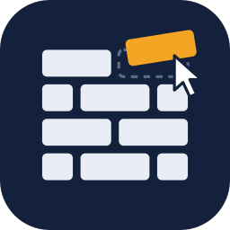

  

# MockMason

MockMason is a desktop mockup tool where you and your AI agent design application screens together. Your agent drafts each screen as movable smart objects, and you can also draft by hand on a grid, link buttons to pages, and talk to your agent about a whole page or a single element.

A product of Fair Harbor Studios.

## Download

Installers are published on this repository's [Releases page](../../releases).

| System | File to download |
| --- | --- |
| Windows (64-bit) | `MockMason-win-Setup.exe` |
| macOS, Intel | `MockMason-osx-x64-Setup.pkg` |
| macOS, Apple Silicon | `MockMason-osx-arm64-Setup.pkg` |

Builds marked "Pre-release" are development versions for testing. They are not signed yet, so Windows and macOS show a warning before opening them.

## About this repository

This repository holds MockMason's installers and update files only. The source code is not published here.

## License

MockMason is proprietary software. See [LICENSE](LICENSE) for the terms of use.

Copyright (c) 2026 Fair Harbor Studios. All rights reserved.
